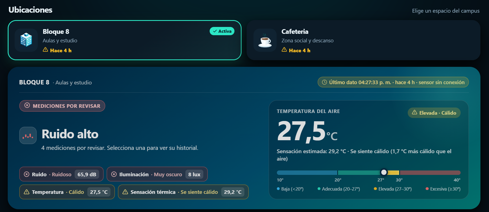
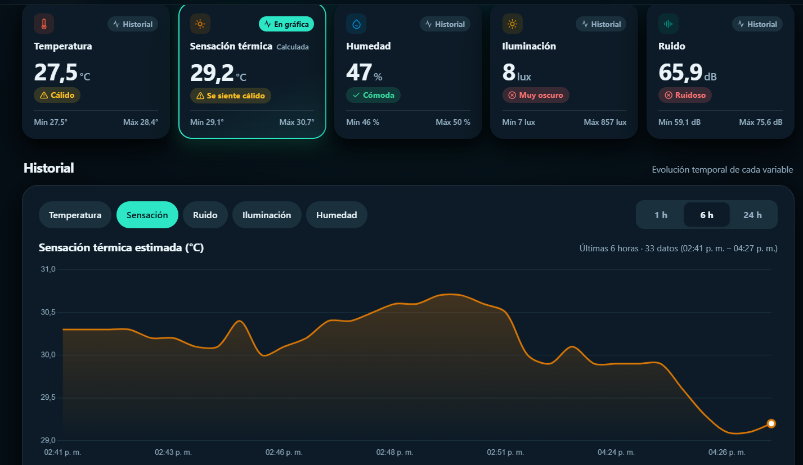

# Monitor ambiental · I. U. Pascual Bravo

Proyecto académico para medir y visualizar condiciones ambientales en distintos espacios del campus. Los nodos con ESP32 envían lecturas a Firebase Realtime Database y el dashboard web muestra el estado actual y el historial.

## Vista previa



*Selección de ubicación, estado del sensor y resumen de las mediciones por revisar.*



*Tarjetas de variables ambientales y gráfica de evolución temporal.*

## Estado del proyecto

- **Bloque 8:** nodo implementado con luz, sonido, temperatura y humedad.
- **Cafetería:** sketch inicial en desarrollo; actualmente envía temperatura y humedad.
- **Dashboard:** consulta los nodos de Firebase y presenta lecturas e historiales.

## Estructura

```text
Esp32-sensores/
├── index.html                 # Dashboard web
├── images/                    # Logos usados por el dashboard
├── docs/images/               # Capturas de la interfaz web
└── IoT/
    ├── Bloque8/
    │   ├── Bloque8.ino
    │   └── secrets.example.h
    └── Cafeteria/
        ├── Cafeteria.ino
        └── secrets.example.h
```

Cada sketch está en una carpeta con el mismo nombre para abrirlo directamente en Arduino IDE. `secrets.h` se crea localmente a partir de la plantilla y está excluido de Git.

## Hardware y conexiones

### Bloque 8

| Componente | Conexión |
|---|---|
| ESP32-S3 | Placa `ESP32S3 Dev Module` |
| VEML7700 | I2C: SDA GPIO 4, SCL GPIO 5 |
| INMP441 | I2S: SCK GPIO 9, WS GPIO 10, SD GPIO 11 |
| DHT22 | DATA GPIO 7 |

### Cafetería

| Componente | Conexión |
|---|---|
| ESP32 DevKit de 38 pines | Placa `ESP32 Dev Module` |
| DHT11 | DATA GPIO 4 |

## Tecnologías y librerías

- **Firmware:** Arduino/C++ para ESP32, Wi-Fi y Firebase Realtime Database.
- **Sensores de Bloque 8:** Adafruit VEML7700, DHT sensor library de Adafruit y Adafruit Unified Sensor; el micrófono INMP441 se lee por I2S.
- **Sensores de Cafetería:** DHT sensor library de Adafruit y Adafruit Unified Sensor.
- **Conexión Firebase:** FirebaseClient de Mobizt.
- **Dashboard:** HTML, CSS y JavaScript; Chart.js y el SDK web de Firebase se cargan desde CDN.

## Preparar y cargar el firmware

1. Instala Arduino IDE, el soporte de placas ESP32 y las librerías indicadas arriba.
2. Abre la carpeta del nodo que vas a configurar: `IoT/Bloque8` o `IoT/Cafeteria`.
3. Copia `secrets.example.h` con el nombre `secrets.h` en esa misma carpeta y completa el Wi-Fi y la URL de Firebase.
4. Abre el archivo `.ino` de esa carpeta y selecciona la placa correspondiente. Para Bloque 8, habilita **Tools → USB CDC On Boot → Enabled**.
5. Carga el programa y abre el monitor serial a **115200 baudios**.

El archivo local `secrets.h` está ignorado por Git para evitar subir credenciales. No reemplaces la plantilla con datos reales dentro del repositorio.

## Ejecutar el dashboard

El dashboard no requiere un proceso de compilación. Para publicarlo con GitHub Pages, conserva `index.html` y la carpeta `images/` en la raíz del sitio. Necesita conexión a internet para consultar Firebase y cargar las librerías del CDN.

Para una vista local, ejecuta desde esta carpeta:

```powershell
python -m http.server 8000
```

Luego abre `http://localhost:8000` en el navegador.

## Datos enviados

Los sketches escriben en `medio_ambiente/nodos/{id}/actual` y agregan lecturas a `medio_ambiente/nodos/{id}/historial`.

- **Bloque 8:** `nombre`, `luz`, `sonido`, `temperatura`, `humedad` y `ts`.
- **Cafetería:** `nombre`, `temperatura`, `humedad` y `ts`.
- Ambos sketches intentan actualizar la lectura actual cada **10 segundos** y guardar una entrada histórica cada tres envíos (aproximadamente **30 segundos**).

## Notas y seguridad

- La lectura de sonido en dB es aproximada y depende de la calibración de `DB_OFFSET`.
- El firmware actual usa Firebase sin autenticación y desactiva la verificación del certificado TLS. Mantén la base de datos de demostración con reglas adecuadas y revisa este esquema antes de usarlo fuera de un entorno controlado.
- Los rangos que presenta el dashboard son criterios del proyecto; no se documentan aquí como una certificación o norma institucional.

## Licencia

Pendiente de definir con el equipo y la universidad. No se ha elegido una licencia abierta para este repositorio.
