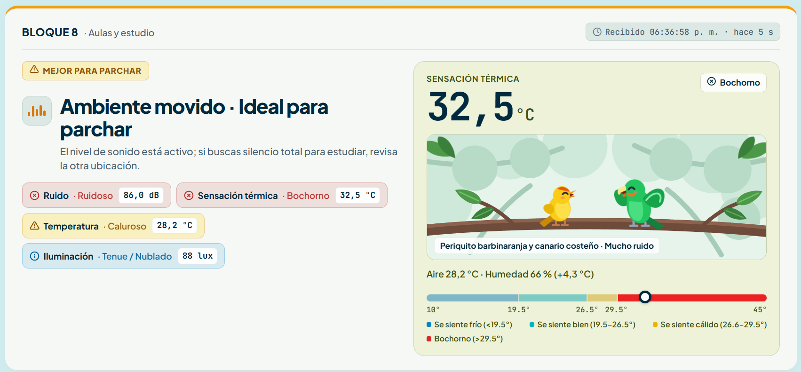
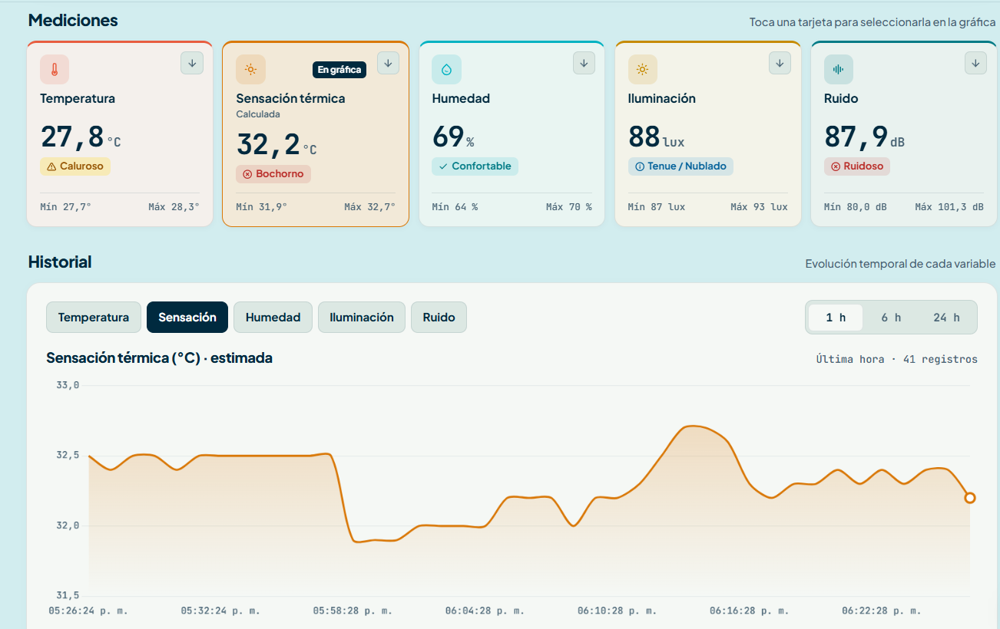
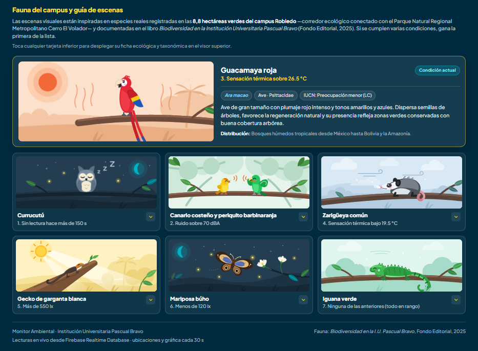

# Monitor ambiental · I. U. Pascual Bravo

Proyecto universitario que se presentará en los PIA de la Institución Universitaria Pascual Bravo. Nodos con ESP32 miden luz, sonido, temperatura y humedad en espacios del campus Robledo y envían las lecturas a Firebase Realtime Database. Un dashboard web muestra el estado actual, el historial y un animal del campus que resume la condición del espacio.

## Vista previa



*Ubicación, hallazgos por variable, sensación térmica como valor principal y la escena del animal activo.*



*Tarjetas de medición con mínimo y máximo, y gráfica de evolución temporal.*



*Los siete animales, su condición de activación y la ficha del animal seleccionado.*

## Qué incluye

- Pantalla de introducción animada al abrir el sitio.
- Selector de ubicaciones con el estado de cada nodo y la hora de la última lectura.
- Panel principal con la **sensación térmica** como valor principal. Debajo se muestran la temperatura del aire, la humedad y la diferencia entre ambas.
- Una escena ilustrada en SVG con el animal que corresponde a la condición actual.
- Tarjetas de medición (temperatura, sensación térmica, humedad, iluminación y ruido) con mínimo y máximo.
- Historial de 1 h, 6 h y 24 h para cada variable.
- Guía de escenas en el pie de página: cada animal con su condición de activación y una ficha ecológica y taxonómica.
- Panel de escenarios de demostración para forzar cada animal sin depender de los sensores.

## Escenas y animales

Cada animal responde a una sola variable. Si varias condiciones se cumplen a la vez, gana la primera de la lista. Cada umbral tiene un pequeño margen de histéresis para que el animal no alterne en el borde.

| # | Animal | Nombre científico | Se activa con | Libro |
|---|---|---|---|---|
| 1 | Currucutú | *Megascops choliba* | Sin lectura hace más de 150 s | p. 22 |
| 2 | Periquito barbinaranja y canario costeño | *Brotogeris jugularis* y *Sicalis flaveola* | Ruido sobre 60 dB | pp. 17 y 28 |
| 3 | Guacamaya roja | *Ara macao* | Sensación térmica sobre 26.5 °C | p. 16 |
| 4 | Zarigüeya común | *Didelphis marsupialis* | Sensación térmica bajo 19.5 °C | p. 35 |
| 5 | Gecko de garganta blanca | *Gonatodes albogularis* | Luz sobre 550 lx | p. 37 |
| 6 | Geen | *Macaria triplicaria* | Luz bajo 120 lx | p. 40 |
| 7 | Iguana verde | *Iguana iguana* | Ninguna de las anteriores | p. 38 |

"Geen" es el nombre que da el libro; indica que la especie no tiene un nombre común reconocido.

### Sensación térmica

El dashboard estima la sensación térmica a partir de la temperatura del aire (*t*, en °C) y la humedad relativa (*h*, en %):

```text
e = (h / 100) · 6.105 · exp(17.27 · t / (237.7 + t))
sensación = t + 0.33 · e − 4.0
```

No considera viento ni radiación solar. Los niveles que usa el panel son: frío bajo 19.5 °C, bien de 19.5 a 26.5 °C, cálido de 26.5 a 29.5 °C y bochorno sobre 29.5 °C. Si un nodo no reporta humedad, el panel muestra la temperatura del aire y lo indica.

## Origen de la información de fauna

Las especies y sus descripciones salen del libro *Biodiversidad en la Institución Universitaria Pascual Bravo* (Fondo Editorial Pascual Bravo, 1.ª edición, noviembre de 2025). El libro documenta la fauna y la flora de las 8.8 hectáreas del campus Robledo, conectado con el Parque Natural Regional Metropolitano Cerro El Volador. De ahí se tomaron los nombres comunes, los nombres científicos, la familia, el estado de amenaza (IUCN), la distribución y la descripción de cada animal. Las ilustraciones SVG se crearon para este proyecto.

## Estado del proyecto

- **Bloque 8:** nodo implementado con luz, sonido, temperatura y humedad.
- **Cafetería:** nodo implementado con luz, sonido, temperatura y humedad.
- **Dashboard:** consulta los nodos de Firebase y muestra lecturas, historial y escenas.
- **Presentación:** pendiente en los PIA de la universidad.

## Estructura

```text
Esp32-sensores/
├── index.html                 # Punto de entrada del dashboard
├── css/
│   ├── base.css               # Estilos base
│   ├── shell.css              # Estructura general de la página
│   ├── dashboard.css          # Panel, mediciones e historial
│   ├── fauna.css              # Guía de fauna y escenas
│   ├── demo.css               # Escenarios de demostración
│   └── responsive.css         # Ajustes para pantallas pequeñas
├── js/
│   ├── config.js              # Configuración
│   ├── dashboard.js           # Lógica principal del dashboard
│   ├── intro.js               # Pantalla de introducción animada
│   ├── utils.js               # Funciones auxiliares
│   ├── data/                  # Datos del dashboard
│   ├── services/              # Acceso a Firebase y a los datos
│   └── ui/                    # Componentes de interfaz
├── images/                    # Logos de la institución
├── docs/images/               # Capturas de la interfaz web
└── IoT/
    ├── Bloque8/
    │   ├── Bloque8.ino
    │   └── secrets.example.h
    └── Cafeteria/
        ├── Cafeteria.ino
        └── secrets.example.h
```

Cada sketch está en una carpeta con el mismo nombre para abrirlo directamente en Arduino IDE. `secrets.h` se crea localmente a partir de la plantilla y está excluido de Git.

## Hardware y conexiones

### Bloque 8

| Componente | Conexión |
|---|---|
| ESP32-S3 | Placa `ESP32S3 Dev Module` |
| VEML7700 | I2C: SDA GPIO 4, SCL GPIO 5 |
| INMP441 | I2S: SCK GPIO 9, WS GPIO 10, SD GPIO 11 |
| DHT22 | DATA GPIO 7 |

### Cafetería

| Componente | Conexión |
|---|---|
| ESP32 DevKit de 38 pines | Placa `ESP32 Dev Module` |
| VEML7700 | I2C: SDA GPIO 21, SCL GPIO 22 |
| INMP441 | I2S: SCK GPIO 18, WS GPIO 19, SD GPIO 23 |
| DHT11 | DATA GPIO 4 |

## Tecnologías y librerías

- **Firmware:** Arduino/C++ para ESP32, Wi-Fi, sincronización de hora por NTP y Firebase Realtime Database.
- **Conexión Firebase:** FirebaseClient de Mobizt (2.x), con inicio de sesión por correo y contraseña.
- **Sensores:** Adafruit VEML7700 (+ Adafruit BusIO), DHT sensor library de Adafruit (+ Adafruit Unified Sensor). El micrófono INMP441 se lee por I2S.
- **Dashboard:** HTML, CSS y JavaScript sin paso de compilación. Chart.js y el SDK web de Firebase se cargan desde CDN.

## Preparar y cargar el firmware

1. Instala Arduino IDE, el soporte de placas ESP32 y las librerías indicadas arriba.
2. En Firebase, activa **Authentication** con correo y contraseña y crea un usuario para el nodo (se recomienda uno por nodo). Anota la API key del proyecto y la URL de Realtime Database.
3. Abre la carpeta del nodo (`IoT/Bloque8` o `IoT/Cafeteria`), copia `secrets.example.h` como `secrets.h` y completa los datos:

   ```cpp
   #pragma once

   // Este archivo NO se sube a GitHub (debe estar en .gitignore).
   #define WIFI_SSID     "nombre-de-la-red"
   #define WIFI_PASSWORD "clave-de-la-red"
   #define DATABASE_URL  "https://tu-proyecto-default-rtdb.firebaseio.com/"

   #define API_KEY       "api-key-del-proyecto-firebase"
   #define USER_EMAIL    "nodo@ejemplo.com"
   #define USER_PASSWORD "clave-del-usuario-del-nodo"
   ```

4. Abre el archivo `.ino` de esa carpeta y selecciona la placa correspondiente. Para Bloque 8, habilita **Tools → USB CDC On Boot → Enabled**.
5. Carga el programa y abre el monitor serial a **115200 baudios**. Si el inicio de sesión no se completa, el monitor muestra "Esperando autenticacion en Firebase" cada 15 s. Cuando funciona, aparece "Firebase actual: OK" en cada envío.

No reemplaces la plantilla `secrets.example.h` con datos reales dentro del repositorio.

## Ejecutar el dashboard

No requiere compilación. Para publicarlo con GitHub Pages, conserva `index.html` y las carpetas `css/`, `js/` e `images/` en la raíz del sitio. Necesita conexión a internet para consultar Firebase y cargar las librerías del CDN.

Para una vista local, ejecuta desde esta carpeta (el dashboard usa módulos de JavaScript, así que no funciona abriendo el archivo directamente):

```powershell
python -m http.server 8000
```

Luego abre `http://localhost:8000` en el navegador.

## Datos enviados

Los sketches escriben en `medio_ambiente/nodos/{id}/actual` y agregan lecturas a `medio_ambiente/nodos/{id}/historial`.

- **Campos:** `nombre`, `luz`, `sonido`, `temperatura`, `humedad` y `ts`. En Cafetería, `luz` se omite si el VEML7700 no responde.
- **Frecuencia:** la lectura actual se actualiza cada **10 segundos** y se guarda una entrada de historial cada seis envíos (aproximadamente **60 segundos**).
- **Señal:** el dashboard muestra un nodo "Sin señal" cuando pasan más de 150 segundos sin lecturas.

## Ajustes de calibración

Cada nodo tiene parámetros de ajuste propios en su sketch, porque usa componentes y montajes distintos. Cafetería aplica `TEMP_OFFSET = -1.7 °C`, `HUM_OFFSET = +15.5` puntos porcentuales, `LUZ_FACTOR = 0.88` y `DB_OFFSET = -19.5`. Bloque 8 aplica `TEMP_OFFSET = 0.0 °C`, `HUM_OFFSET = 0.0`, `LUZ_FACTOR = 1.0` y `DB_OFFSET = +14.5`.

Estos valores son ajustes prácticos para acercar las lecturas de ambos nodos a las referencias usadas en el proyecto y hacerlas más comparables. No son una calibración metrológica certificada. El DHT11 es menos preciso que el DHT22 y los valores de sonido en dB son aproximados. Si se reemplaza un sensor, cambia su ubicación o se compara con otra referencia, hay que volver a validar los parámetros. El VEML7700 usa lectura automática (`VEML_LUX_AUTO`) en ambos nodos.

## Notas y seguridad

- Los nodos escriben en Firebase con un usuario de Authentication. Las credenciales viven solo en `secrets.h`, que Git ignora.
- El firmware desactiva la verificación del certificado TLS (`setInsecure()`). Es aceptable para una demostración, pero conviene revisarlo antes de usar el sistema fuera de un entorno controlado.
- Configura las reglas de Realtime Database para que solo los usuarios autenticados puedan escribir.
- La lectura de sonido en dB es aproximada y depende de `DB_OFFSET`.
- Los rangos y umbrales del dashboard son criterios del proyecto. No se documentan como certificación ni norma institucional.

## Créditos y licencia

La información de fauna proviene del libro *Biodiversidad en la Institución Universitaria Pascual Bravo* (Fondo Editorial Pascual Bravo, 2025), cuya página legal lo publica bajo licencia Creative Commons Reconocimiento-NoComercial 4.0 Internacional. Las ilustraciones SVG se crearon para este proyecto.

La licencia del código está pendiente de definir con el equipo y la universidad. No se ha elegido una licencia abierta para este repositorio.
